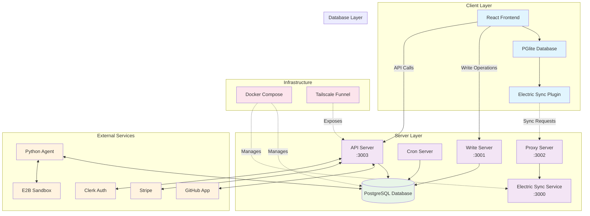
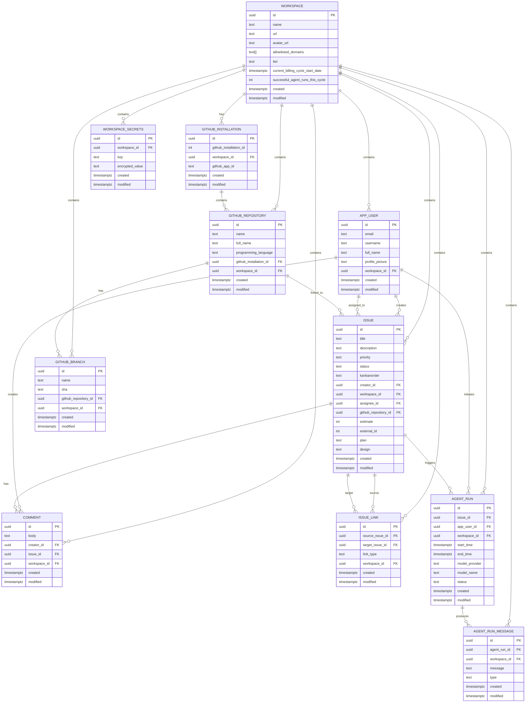
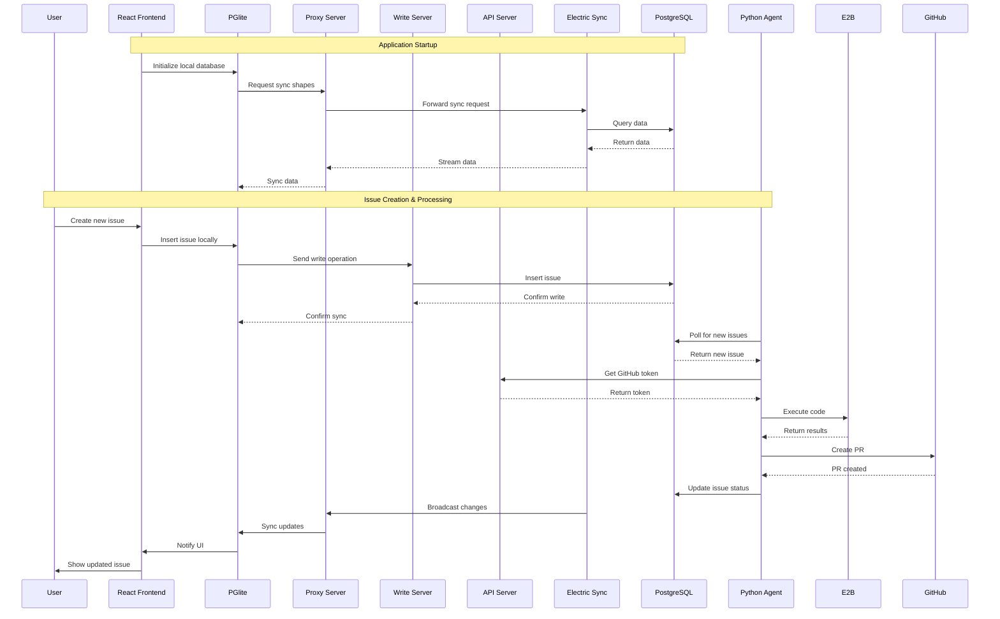

# Wallie System Architecture

## Overview
Wallie is a local-first issue tracking application that provides offline functionality with real-time synchronization. It follows a distributed architecture pattern where each client maintains a local database (PGlite) that stays synchronized with a central PostgreSQL database via ElectricSQL.

## System Architecture

## Data Model

## Component Interactions

## Data Flow Patterns

```mermaid
flowchart TD
    subgraph "Write Path"
        W1[User Action] --> W2[Local PGlite Update]
        W2 --> W3[Write Server]
        W3 --> W4[PostgreSQL]
        W4 --> W5[Electric Sync]
        W5 --> W6[Broadcast to Clients]
    end
    
    subgraph "Read Path"
        R1[User Query] --> R2[Local PGlite Query]
        R2 --> R3[Instant Response]
    end
    
    subgraph "Sync Path"
        S1[Electric Sync Service] --> S2[Proxy Server]
        S2 --> S3[PGlite Sync Plugin]
        S3 --> S4[Local Database Update]
        S4 --> S5[UI Refresh]
    end
    
    subgraph "Conflict Resolution"
        C1[Server Change] --> C2[Check Local Modifications]
        C2 --> C3{Conflict?}
        C3 -->|Yes| C4[Merge Strategy]
        C3 -->|No| C5[Apply Change]
        C4 --> C6[Update Local State]
        C5 --> C6
    end
    
    subgraph "Agent Workflow"
        A1[Issue Created] --> A2[Agent Monitors DB]
        A2 --> A3[Process Issue]
        A3 --> A4[Execute Code in E2B]
        A4 --> A5[Create GitHub PR]
        A5 --> A6[Update Issue Status]
    end
    
    %% Styling
    classDef writeFlow fill:#ffebee
    classDef readFlow fill:#e8f5e8
    classDef syncFlow fill:#e3f2fd
    classDef conflictFlow fill:#fff3e0
    classDef agentFlow fill:#f3e5f5
    
    class W1,W2,W3,W4,W5,W6 writeFlow
    class R1,R2,R3 readFlow
    class S1,S2,S3,S4,S5 syncFlow
    class C1,C2,C3,C4,C5,C6 conflictFlow
    class A1,A2,A3,A4,A5,A6 agentFlow
```

## Key Features

### Local-First Architecture
- **PGlite**: In-browser SQL database for offline functionality
- **Electric Sync**: Real-time bidirectional synchronization
- **Conflict Resolution**: Automatic merging of concurrent changes
- **Optimistic Updates**: Immediate UI feedback before server confirmation

### GitHub Integration
- **GitHub App**: OAuth-based repository access
- **Webhook Integration**: Real-time updates from GitHub
- **PR Creation**: Automated pull request generation via AI agent
- **Repository Management**: Multi-repository support per workspace

### AI Agent System
- **Python Agent**: Autonomous issue processing
- **E2B Integration**: Secure code execution environment
- **Multi-model Support**: Configurable AI model providers
- **Workspace Isolation**: Tenant-specific agent runs

### Security & Authentication
- **Clerk Integration**: User authentication and management
- **Workspace Isolation**: Multi-tenant data separation
- **Rate Limiting**: API protection across all servers
- **Encryption**: Secure storage of sensitive data

### Scalability Features
- **Horizontal Scaling**: Multiple server instances
- **Caching**: Efficient data synchronization
- **Database Optimization**: Indexed queries and FTS
- **Resource Management**: Configurable limits and tiers

## Technology Stack

### Frontend
- **React 18**: Component-based UI framework
- **TypeScript**: Type-safe development
- **Tailwind CSS**: Utility-first styling
- **Vite**: Fast build tooling

### Backend
- **Node.js**: JavaScript runtime
- **Hono**: Lightweight web framework
- **PostgreSQL**: Primary database
- **ElectricSQL**: Real-time sync service

### Infrastructure
- **Docker Compose**: Local development environment
- **Tailscale**: Secure networking for webhooks
- **Stripe**: Payment processing
- **Clerk**: Authentication service

### AI/ML
- **Python Agent**: Custom AI processing
- **E2B**: Code execution sandbox
- **Multi-provider**: Support for various LLM providers

This architecture provides a robust, scalable foundation for a local-first collaborative issue tracking system with advanced AI capabilities.